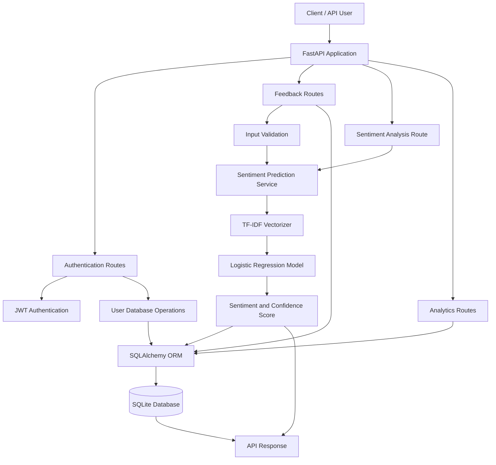

# System Architecture

## 1. Architecture Overview

The Smart Feedback Intelligence System follows a layered backend architecture.

It uses FastAPI to handle API requests, SQLAlchemy to communicate with the SQLite database, and a trained Machine Learning model to predict customer feedback sentiment.

## 2. System Architecture Diagram

## 3. Main Components

### Client / API User
- Sends requests to the backend APIs.
- Receives responses from the system.

### FastAPI Application
- Handles incoming HTTP requests.
- Routes requests to the appropriate API modules.
- Provides Swagger UI documentation.

### Authentication Module
- Handles user registration and login.
- Uses bcrypt for password hashing.
- Generates and validates JWT access tokens.

### Feedback Module
- Creates, retrieves, updates, and deletes feedback.
- Supports searching, filtering, and pagination.
- Stores feedback records in the database.

### Sentiment Analysis Module
- Uses the saved TF-IDF vectorizer.
- Uses the trained Logistic Regression model.
- Predicts Positive, Negative, or Neutral sentiment.
- Calculates a confidence score.

### Analytics Module
- Calculates total feedback counts.
- Provides sentiment distribution.
- Generates daily feedback and sentiment trends.

### Database Layer
- Uses SQLAlchemy as the ORM.
- Stores user and feedback records in SQLite.

## 4. Feedback Prediction Workflow

1. The user submits customer feedback through the API.
2. FastAPI receives and validates the request.
3. The sentiment service processes the feedback text.
4. TF-IDF converts text into numerical features.
5. Logistic Regression predicts the sentiment.
6. The system calculates the confidence score.
7. SQLAlchemy stores the feedback and prediction in SQLite.
8. FastAPI returns the response to the user.

## 5. Technology Summary

| Component | Technology |
|---|---|
| Backend | Python and FastAPI |
| Authentication | JWT and bcrypt |
| Validation | Pydantic |
| Database ORM | SQLAlchemy |
| Database | SQLite |
| Text Vectorization | TF-IDF |
| ML Algorithm | Logistic Regression |
| API Documentation | Swagger UI |
| Testing | Pytest |

## 6. Architecture Summary

The architecture separates API routes, authentication, database operations, and Machine Learning services into different components.

This structure makes the application easier to maintain, test, and extend.

